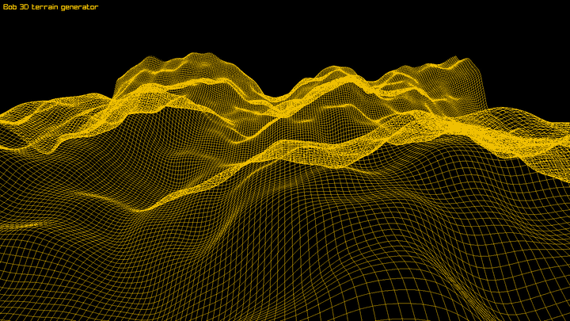

# 3D Terrain Generator


A real-time 3D terrain generator written in C# with Raylib-cs. The heights come from a hand-written Perlin noise with a seeded permutation table, layered into four octaves of fractional Brownian motion. The result is a 240x200 wireframe landscape that is recalculated and redrawn every frame as it scrolls. At startup a voxel-style BOB logo built from cubes rises out of view.

<p align="center">
  
</p>

## Technologies

* C#
* .NET 10
* Raylib-cs
* System.Numerics

## How to run

Install the [.NET 10 SDK](https://dotnet.microsoft.com/download) and run these commands.

```bash
git clone https://github.com/Zambrzyckii/terraingenerator.git
cd terraingenerator/TerrainGenerator
dotnet run
```
